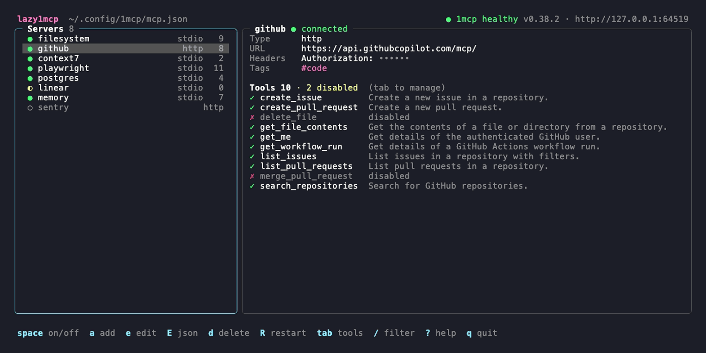
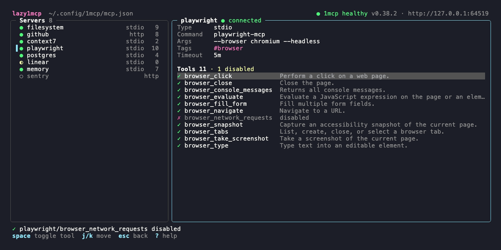
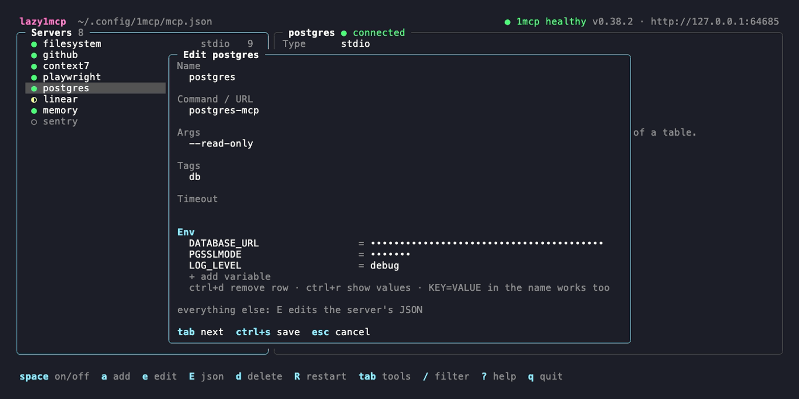
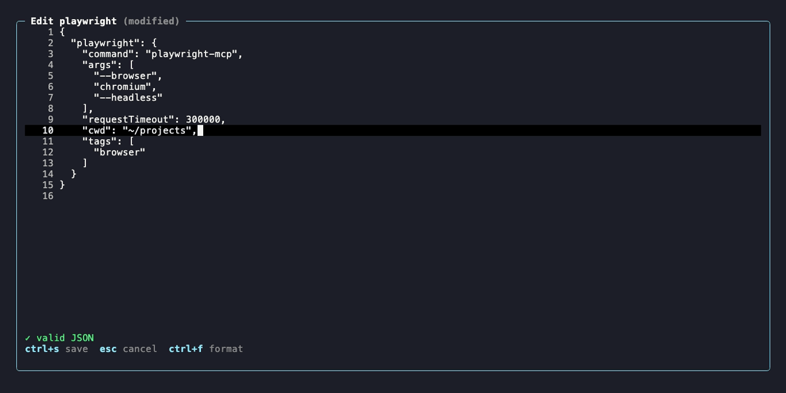
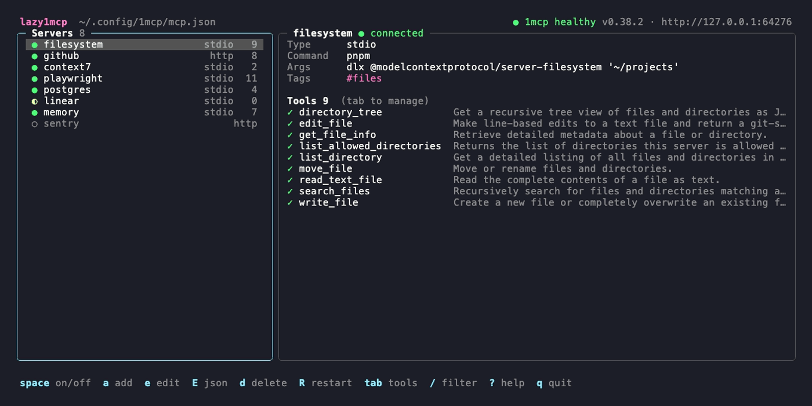

# lazy1mcp

A terminal UI for [1MCP](https://github.com/1mcp-app/agent). 1MCP bundles all your MCP servers behind one endpoint, so every AI harness (Claude Code, Codex, Cursor, …) gets the same set. lazy1mcp shows you what that set looks like right now and lets you change it without hand-editing `mcp.json`.

- See every configured server with its **live status** from the running 1MCP service (connected, awaiting OAuth, not loaded, disabled) and its **tools**.
- **Enable or disable** a server, or single tools, with one key.
- **Add, edit, rename and remove** servers in a form: command or URL, args, env variables or headers, tags, timeout.
- Edit anything else in the **built-in JSON editor**, which checks the JSON while you type.



*Servers on the left with their status and tool count, the selected server on the right. Secrets (env values, headers) are masked.*

## How it works

lazy1mcp edits the 1MCP config file (default `~/.config/1mcp/mcp.json`) and nothing else. 1MCP reloads that file by itself (config hot-reload, on by default) and connects, disconnects or reconfigures the affected servers within a second or two. lazy1mcp then picks up the new state.

- **Status and tools** come from the running service: `GET /health` and `1mcp inspect --format json`. When 1MCP is not running, the header says so and you can still edit the config.
- **Saving** is atomic, and the previous file is kept as `mcp.json.bak`. Keys lazy1mcp does not know, and the order of keys, are preserved. lazy1mcp writes the same two-space layout as 1MCP.
- **Outside edits** to `mcp.json` (by you, `1mcp mcp add`, …) are noticed and reloaded.
- **Disabled tools** go into the server's `disabledTools` list. 1MCP hides them from clients, and lazy1mcp keeps showing them so you can turn them back on.



*`tab` moves into the tool list, and `space` disables or enables the selected tool.*

## Keys

| Key | Does |
|---|---|
| `j`/`k`, `↑`/`↓`, `g`/`G` | move |
| `tab`, `enter` | switch to the tool list (`esc` or `tab` goes back) |
| `space` | enable/disable the server, or in the tool list the tool |
| `a` | add a server |
| `e` | edit the server in a form |
| `E` | edit the server's JSON |
| `O` | edit the whole `mcp.json` |
| `d` | remove the server (asks first) |
| `R` | restart the server: it is disabled and enabled again, so 1MCP reconnects it |
| `r` | refresh status and tools now (otherwise every 10 s) |
| `s` | show or hide env values and headers |
| `/` | filter by name or tag |
| `?` | help |
| `q` | quit |

### Form



*Env variables (stdio servers) or headers (HTTP servers) are a key/value list. Values stay masked unless you are typing in them.*

- **Command / URL**: a path or command for stdio servers, or an `http(s)://` URL for remote ones. A pasted command line such as `pnpm dlx some-mcp --flag` is split into command and args.
- **Args**: shell-style, so quotes work (`--title 'two words'`).
- **Env / Headers**: on **+ add**, just start typing, or press `enter`. `KEY=VALUE` typed into the name is split for you, and `ctrl+d` removes a row. `ctrl+r` shows all values.
- **Timeout**: `300`, `300s` or `5m`. It becomes `requestTimeout` in milliseconds. Leave it empty to use the 1MCP default.
- `tab` moves to the next field, `ctrl+s` saves, `esc` cancels.

### JSON editor



*`E` opens the selected server as `{"name": {...}}`, and `O` opens the whole file. The status line shows the first syntax error with line and column.*

`ctrl+s` saves after checking the JSON. Invalid JSON is never written. `esc` cancels and asks first if you changed something. `ctrl+f` formats the JSON, and `enter` keeps the indentation. If `$VISUAL` or `$EDITOR` is set, `ctrl+o` opens the content there, and the result comes back into the editor.

## Install

```sh
brew install baeroe/tap/lazy1mcp
```

The formula in [baeroe/homebrew-tap](https://github.com/baeroe/homebrew-tap) builds from the tagged source.

From source (Go 1.26+):

```sh
make install          # builds to ~/.local/bin/lazy1mcp
# or: go build -o ~/.local/bin/lazy1mcp .
```

`make build` builds `bin/lazy1mcp`, and `make test` runs all tests.

To run it in a [herdr](https://herdr.dev) pane, use [herdr-lazy1mcp](https://github.com/baeroe/herdr-lazy1mcp).

### Options

| Flag | Env | Default |
|---|---|---|
| `--config` | `ONE_MCP_CONFIG` | `~/.config/1mcp/mcp.json` |
| `--url` | `LAZY1MCP_URL` | `http://127.0.0.1:3050` |
| `--bin` | `LAZY1MCP_BIN` | `1mcp` from `PATH`, then the usual pnpm/npm global locations |

`lazy1mcp version` prints the version.

### Releasing

```sh
git tag v0.2.0 && git push origin v0.2.0
```

The `Release` workflow runs the tests and publishes a GitHub release with generated notes. The tap bumps its formula to the new release within an hour.

## Tests

```sh
make test             # gofmt + go vet + go test -race ./...
```

The config tests check that a load/save round trip keeps unknown keys and their order. The TUI tests drive the model with key presses against temporary config files: toggles, forms, the JSON editor, filter, delete and restart.

## Screenshots



The images in `docs/screenshots/` are rendered from the [VHS](https://github.com/charmbracelet/vhs) tapes in `docs/tapes/` with demo data only:

```sh
brew install vhs pngquant oxipng   # vhs pulls ttyd and ffmpeg
make screenshots                   # or: bash docs/screenshots.sh form
```

The script runs everything in a throwaway sandbox with its own `HOME`, a copy of the demo config `docs/demo/mcp.json`, and `docs/demo/fake1mcp.go` in place of the 1mcp CLI and service. No real 1MCP, MCP server, account or token is involved.

## License

MIT, see [LICENSE](LICENSE).
